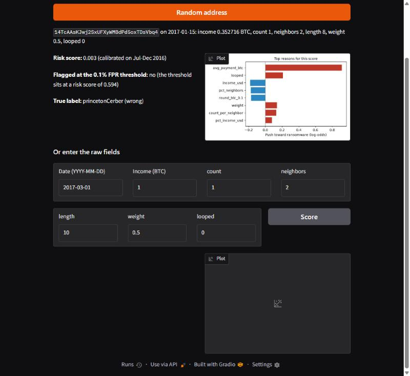

# Bitcoin Ransomware Detection

I started this as my final year project (B.Tech IT, Anna University, 2024): a Random Forest on the
BitcoinHeist dataset that scored 98.65% accuracy. Then I tested it the way it would actually be used,
on later years and on ransomware it had never seen, and most of that number went away. This repo is
the rebuilt version: a time-based evaluation, payment-behavior features, an outside test on newer
ransomware, and a small demo.

**Short version:** with a random split the old setup looks strong because the same addresses and
the same weeks land on both sides. Trained on data before July 2016 and tested on 2017-18, every
model I tried ranks ransomware only slightly better than chance. On Ransomwhere it catches about 45%
of the unseen addresses from families BitcoinHeist already has (mostly Locky, 2016), and none from
families it has never seen.

Live demo: not deployed yet. `app/` holds a Gradio app ready for a Hugging Face Space (see
[Demo](#demo)).

## Results

All numbers below are written into this file by `ransomdet export-demo` from `reports/*.json`.

<!-- results:start -->
| Setup | Test PR-AUC | Recall at 0.1% FPR | Accuracy |
| --- | --- | --- | --- |
| FYP protocol: random 80/20 split, Random Forest | 0.412 | 0.194 | 0.9856 |
| Time split, 6 original features (Baseline B) | 0.007 | 0.001 | - |
| Time split, final LightGBM, 21 features | 0.015 | 0.001 | - |

Time split: train before 2016-07-01, validate until 2017-01-01, test on 2017-18. The test base rate is 0.0049, which is what a random ranker scores as PR-AUC. On validation the final model reaches PR-AUC 0.325.

Leave one family out (recall on the held-out family, threshold re-fixed at 0.1% FPR):

| Held-out family | Addresses | Recall | Test white FPR |
| --- | --- | --- | --- |
| princetonCerber | 9,177 | 0.002 | 0.06% |
| princetonLocky | 6,584 | 0.000 | 0.05% |
| paduaCryptoWall | 1,894 | 0.000 | 0.08% |
| montrealCryptoLocker | 1,509 | 0.000 | 0.00% |
| montrealCryptXXX | 1,354 | 0.001 | 0.05% |

Ransomwhere outside test (addresses not in BitcoinHeist, portable features only):

| Slice | Addresses | Address recall |
| --- | --- | --- |
| all addresses | 1,084 | 0.031 |
| families also in BitcoinHeist | 75 | 0.453 |
| families new to BitcoinHeist | 288 | 0.000 |
| of which NotNevada | 3 | 0.000 |
| new families without NotNevada | 285 | 0.000 |
| Unlabeled | 721 | 0.000 |
| payments after 2018 | 962 | 0.000 |
<!-- results:end -->

Full reports: [data audit](reports/data_audit.md), [baselines](reports/baselines.md),
[feature ablation](reports/feature_ablation.md), [final model](reports/final_model.md),
[generalization](reports/generalization.md), [explanation](reports/explanation.md).

## What I changed and why

- **Split by time, and by address.** I train on everything before 2016-07-01, validate on July to
  December 2016 and test on 2017-18. An address that appears in more than one period stays only in
  the earliest one. A random split shares about 34,000 test rows with training addresses.
- **Binary detection first.** The question is "is this a ransom payment address", scored per
  address and day. Family attribution is a later, optional step.
- **Metrics an analyst would use.** Recall at a 0.1% false-positive rate (about one false alarm per
  day at 1,000 benign addresses a day), PR-AUC, and precision in the top 10 alerts per day. Accuracy
  only shows up in the old-protocol row.
- **No date features.** `year` and `day` carried 57% of the old model's SHAP importance. I removed
  them and added features based on how ransom gets paid: income in dollars at that day's BTC price,
  distance to round dollar and BTC amounts, average payment size, and rank among all addresses that
  day.
- **Tests it never saw.** Leave-one-family-out on BitcoinHeist, and
  [Ransomwhere](https://zenodo.org/records/13999026) addresses that are not in BitcoinHeist, scored
  with only the features its payment list can rebuild.

## What the data showed

- `count` is a merge measure (how many earlier transactions feed into the address that day), not a
  transaction count. `neighbors` is the number of transactions that pay into the address. The old
  README had both wrong; [data/README.md](data/README.md) has the corrected definitions.
- 2018 has 3 ransomware rows, so the test period is in practice 2017, and 93% of that is Cerber.
- Most 2017 ransomware is paid in round BTC amounts, but so are about 14% of benign rows, which is far
  too many for a 0.1% false-positive budget.

## Run it

Needs Python 3.12+ and about 5 GB of free RAM. Everything runs on CPU.

```bash
git clone https://github.com/theavinash02/bitcoin-ransomware-detection.git
cd bitcoin-ransomware-detection
python -m venv .venv
source .venv/bin/activate        # Windows: .venv\Scripts\activate
pip install -e ".[dev,app]"
ransomdet all                    # or: make all
```

`ransomdet all` downloads the three data sources into `data/raw/`, then runs every stage and writes
the reports. On my 8 GB laptop it takes about 17 minutes, with peak memory near 2.4 GB.
`ransomdet all --dev` does the same on a 200k-row sample in a few minutes. Individual steps:
`download`, `prepare`, `train`, `evaluate`, `features`, `final`, `generalize`, `explain`,
`export-demo`. Settings live in [configs/default.yaml](configs/default.yaml).

```bash
pytest -q                        # unit tests plus a 5,000-row end-to-end smoke test
```

## Demo

`ransomdet export-demo` copies the model, its calibration, the threshold, per-day quantile tables and
an enriched 5,000-row test sample into `app/artifacts/` (under 10 MB). To try it locally:

```bash
cd app && python app.py
```



To publish it, create a Gradio Space on Hugging Face and push the contents of `app/` to it.


## Layout

```
src/ransomdet/   data, audit, split, features, train, baselines, ablation, final_model,
                 generalization, explain, readme, demo, cli
configs/         every setting, seed and threshold
reports/         stage reports, metrics JSON, figures
app/             Gradio demo for a Hugging Face Space
tests/           unit tests, smoke test, fixtures
scripts/         rebuild the test fixture and the report notebook
notebooks/       report.ipynb walkthrough; archive/ holds the original FYP notebook
docs/            SPEC.md, MODEL_CARD.md
```

## Limitations

- BitcoinHeist keeps at most 1,000 benign addresses per day out of hundreds of thousands, so
  precision here says nothing about real-world alert rates.
- `white` means "not on the three ransomware lists", not "checked and benign".
- The demo scores BitcoinHeist fields for 2011-2018 dates. It cannot look up a live address.
- Ransomwhere features are rebuilt from attributed payments and only approximate BitcoinHeist's
  definitions.
- Probabilities are calibrated on late 2016, when ransomware was 3.7% of rows. On 2017-18 (0.5%) they
  run high.

More in [docs/MODEL_CARD.md](docs/MODEL_CARD.md).

## Data credits

- BitcoinHeist: C. G. Akcora, Y. Li, Y. R. Gel, M. Kantarcioglu. *BitcoinHeist: Topological Data
  Analysis for Ransomware Prediction on the Bitcoin Blockchain.* IJCAI 2020.
  [UCI #526](https://archive.ics.uci.edu/dataset/526/bitcoinheistransomwareaddressdataset), CC BY 4.0.
- Ransomwhere: J. Cable, I. Gregory, L. Izhikevich, Z. Durumeric.
  [Zenodo v1.1.0](https://zenodo.org/records/13999026), CC BY 4.0.
- BTC/USD daily prices: [Coin Metrics community data](https://docs.coinmetrics.io/packages/coin-metrics-community-data),
  CC BY-NC 4.0.

## License

MIT, see [LICENSE](LICENSE).
