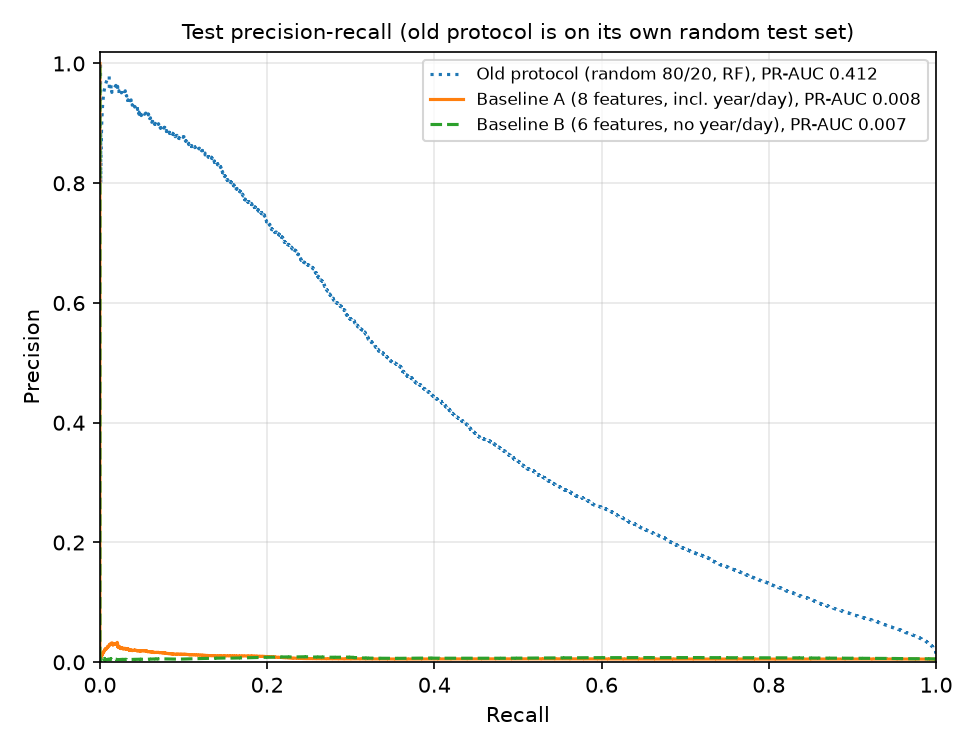

# Forward-in-time baselines

Generated by `ransomdet train` and `ransomdet evaluate`. Training took 47.2 s with peak memory 1710 MB.

Removing `year` and `day` moves test PR-AUC from 0.008 (A) to 0.007 (B), and recall at 0.1% FPR from 0.025 to 0.001. The old random-split protocol scores 0.412 PR-AUC on its own test set.

## Results

| Run | Test PR-AUC | Recall at FPR 0.1% | Test FPR at that threshold | Precision in top 10/day (ceiling) | Brier (uncalibrated) | Val PR-AUC | Accuracy | Weighted F1 |
| --- | --- | --- | --- | --- | --- | --- | --- | --- |
| Old protocol (random 80/20, RF) | 0.412 | 0.194 | 0.09% | 0.119 (0.227) | 0.0170 | 0.404 | 0.9856 | 0.9845 |
| Baseline A (8 features, incl. year/day) | 0.008 | 0.025 | 0.52% | 0.005 (0.270) | 0.1690 | 0.286 | - | - |
| Baseline B (6 features, no year/day) | 0.007 | 0.001 | 0.10% | 0.005 (0.270) | 0.2114 | 0.164 | - | - |

Each threshold is fixed on validation at 0.1% FPR, then applied to test. Precision in the top 10 is pooled over all test days (hits / (10 x days)). The ceiling is what a perfect ranker would get, since most test days have fewer than 10 ransomware rows. Brier scores come from a class-weighted model trained on thinned data, so they are not calibrated yet (see the final model report). Accuracy and weighted F1 are given for the old protocol only, at a 0.5 cutoff.

Leave-one-family-out and Ransomwhere recall are in the generalization report.

## Test years separately

| Run | Year | Rows | Ransomware rows | Recall | FPR |
| --- | --- | --- | --- | --- | --- |
| Baseline A (8 features, incl. year/day) | 2017 | 363,524 | 3,423 | 0.025 | 0.44% |
| Baseline A (8 features, incl. year/day) | 2018 | 328,209 | 1 | 0.000 | 0.61% |
| Baseline B (6 features, no year/day) | 2017 | 363,524 | 3,423 | 0.001 | 0.09% |
| Baseline B (6 features, no year/day) | 2018 | 328,209 | 1 | 0.000 | 0.12% |

## Split used

Split C: train before 2016-07-01, validation until 2017-01-01, test after. 12,168 rows were dropped because their address already appeared in an earlier split. Training keeps 15% of white rows: 330,390 rows, 31,059 of them ransomware. Validation (184,453 rows) and test (691,733 rows) use every row.

## Old protocol details

Random stratified 80/20 split over all rows, binary labels, the FYP forest settings (100 trees, max depth 20, min leaf 25). For memory, the forest is fit on the 80% with white rows thinned the same way (330,516 rows). A random eighth of the 80% (291,670 rows) is held back only to fix the FPR threshold. 34,288 of the 583,340 test rows belong to addresses the forest saw in training.

## Runs

| Model | Trees | Fit time (s) |
| --- | --- | --- |
| Baseline A (8 features, incl. year/day) | 440 (early stopped) | 14.7 |
| Baseline B (6 features, no year/day) | 79 (early stopped) | 4.9 |
| Old protocol (random 80/20, RF) | 100 | 22.5 |
