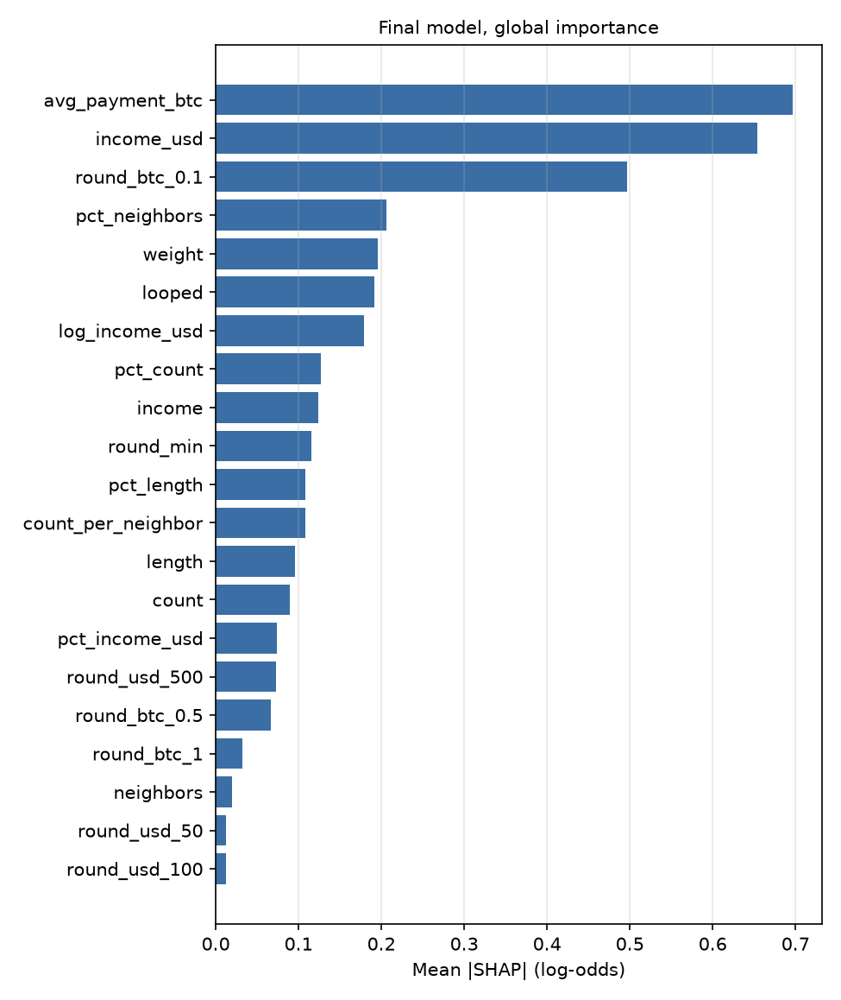
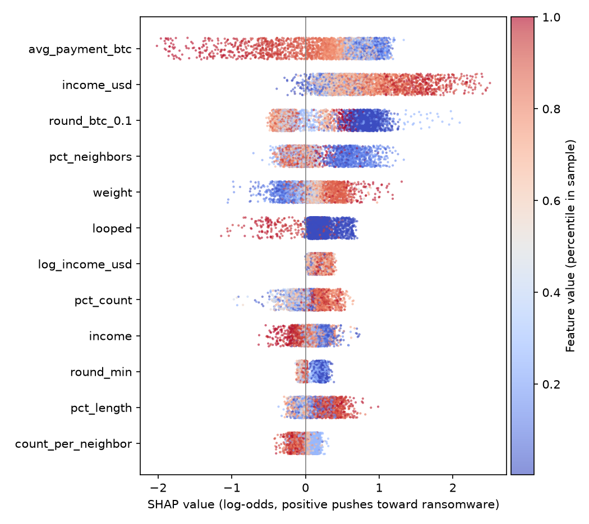
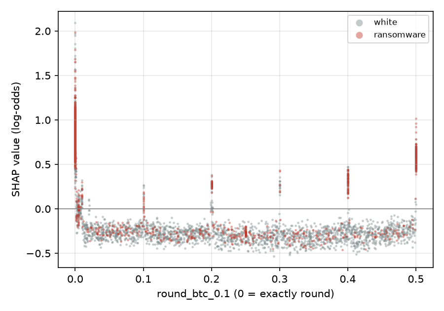
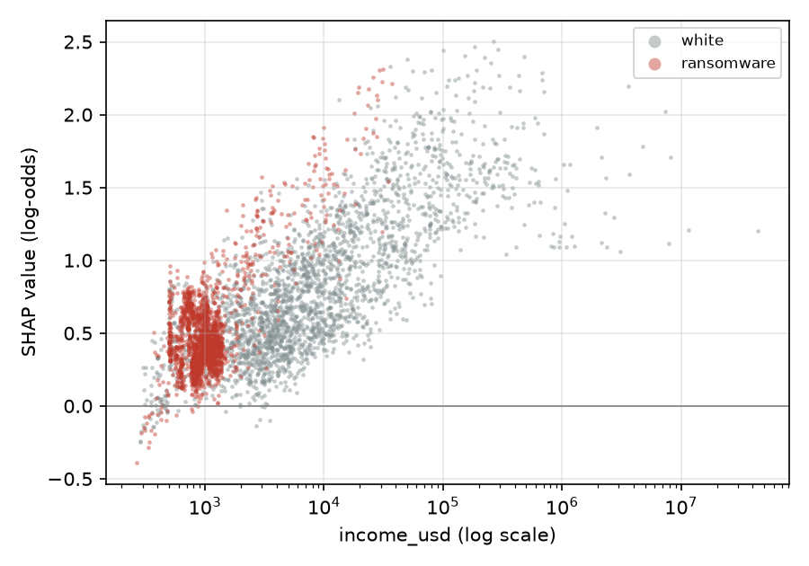
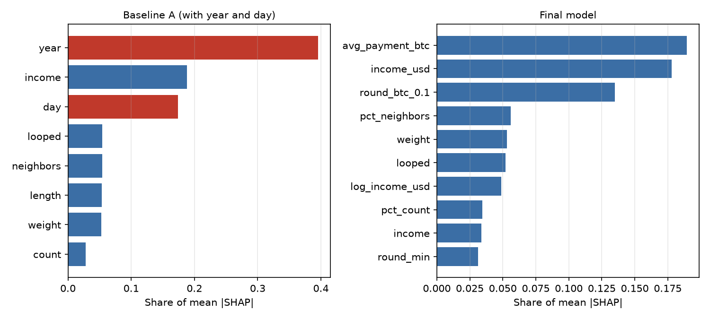

# What drives the detector

Generated by `ransomdet explain`. Runtime 25.9 s, peak memory 2252 MB.

SHAP values come from LightGBM's built-in contributions (`pred_contrib=True`) on 5,000 test rows, 2,500 of them ransomware. Values are in log-odds of the raw model, before calibration.

## Findings

1. The three largest drivers are `avg_payment_btc`, `income_usd`, `round_btc_0.1`; together they carry 50% of the mean absolute SHAP value.
2. `year` and `day` carry 57% of Baseline A's mean absolute SHAP value. The final model has no date inputs; date enters only through the dollar price lookup and the same-day percentiles.
3. Only 3 of 3,322 test ransomware addresses (0.1%) have a day above the threshold. princetonCerber accounts for 3,171 of the missed addresses.
4. Caught addresses have median income $1,263 against $962 for missed ones and $6,570 for white rows.
5. Most test ransomware is paid in round BTC: 71% of missed rows sit within 1% of a 0.1 BTC multiple, against 14% of white rows. That rule alone, checked after the fact on test, finds 71% of test ransomware rows at 2.5% precision (base rate 0.5%). The model does not rank these rows high enough to pass a 0.1% FPR threshold, because round amounts are common enough among white rows that the signal alone is far from that strict.

## Global importance

| Feature | Mean abs SHAP | Share |
| --- | --- | --- |
| `avg_payment_btc` | 0.6966 | 18.9% |
| `income_usd` | 0.6542 | 17.8% |
| `round_btc_0.1` | 0.4963 | 13.5% |
| `pct_neighbors` | 0.2063 | 5.6% |
| `weight` | 0.1960 | 5.3% |
| `looped` | 0.1913 | 5.2% |
| `log_income_usd` | 0.1795 | 4.9% |
| `pct_count` | 0.1269 | 3.5% |
| `income` | 0.1239 | 3.4% |
| `round_min` | 0.1155 | 3.1% |
| `pct_length` | 0.1081 | 2.9% |
| `count_per_neighbor` | 0.1080 | 2.9% |
| `length` | 0.0956 | 2.6% |
| `count` | 0.0896 | 2.4% |
| `pct_income_usd` | 0.0738 | 2.0% |
| `round_usd_500` | 0.0729 | 2.0% |
| `round_btc_0.5` | 0.0664 | 1.8% |
| `round_btc_1` | 0.0319 | 0.9% |
| `neighbors` | 0.0198 | 0.5% |
| `round_usd_50` | 0.0122 | 0.3% |
| `round_usd_100` | 0.0120 | 0.3% |

## Dependence

## Date shortcut: Baseline A vs final model

## Caught vs missed test ransomware

An address is caught when any of its test days crosses the final model's threshold. Medians per row:

| Feature | Caught | Missed | White (test) |
| --- | --- | --- | --- |
| `income_usd` | 1,263 | 961.7 | 6,570 |
| `income_btc` | 1.2 | 0.8 | 1.17 |
| `round_min` | 2.22e-15 | 0 | 0.05095 |
| `round_usd_100` | 0.1812 | 0.2406 | 0.2481 |
| `round_btc_0.1` | 2.22e-15 | 0 | 0.2071 |
| `neighbors` | 2 | 2 | 2 |
| `count` | 1 | 1 | 1 |
| `length` | 0 | 8 | 10 |
| `weight` | 0.5 | 0.125 | 0.5 |
| `pct_income_usd` | 0.4965 | 0.3355 | 0.5003 |

| Family | Caught addresses | Missed addresses |
| --- | --- | --- |
| princetonCerber | 3 | 3,171 |
| montrealDMALockerv3 | 0 | 70 |
| princetonLocky | 0 | 40 |
| montrealSamSam | 0 | 16 |
| montrealCryptConsole | 0 | 5 |
| montrealWannaCry | 0 | 5 |
| montrealXLockerv5.0 | 0 | 3 |
| montrealEDA2 | 0 | 3 |
| montrealGlobev3 | 0 | 3 |
| montrealFlyper | 0 | 1 |
| montrealGlobe | 0 | 1 |
| montrealXLocker | 0 | 1 |
