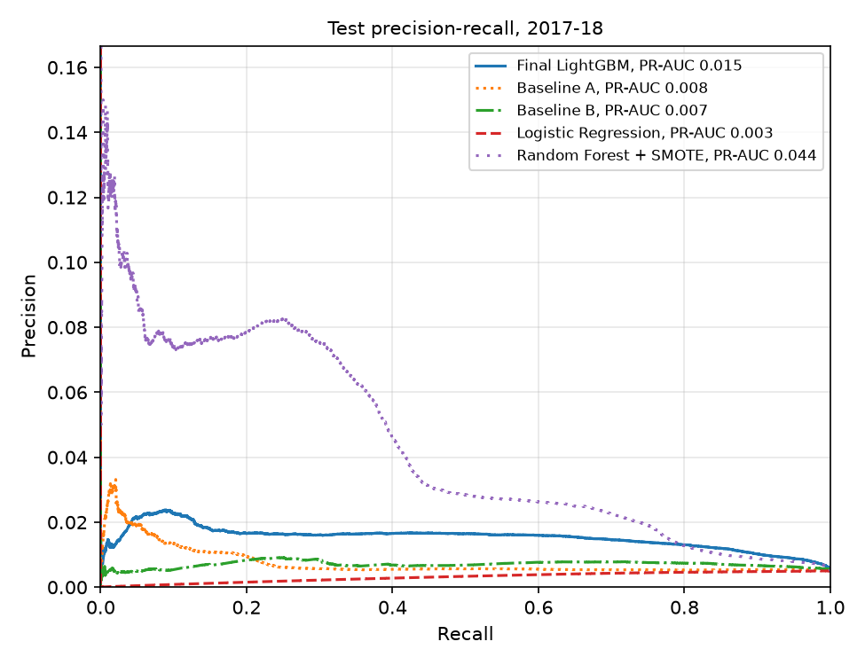
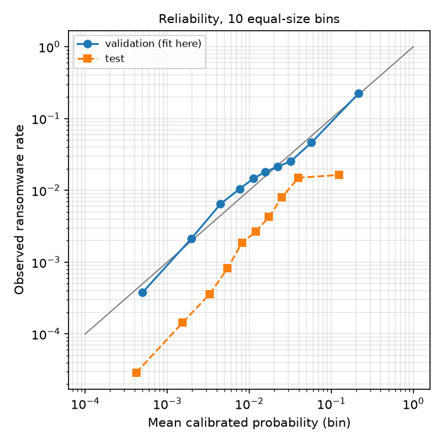

# Final model and operating point

Generated by `ransomdet final`. Runtime 458.4 s, peak memory 2394 MB.

On the test years the tuned model reaches PR-AUC 0.015 and recall 0.001 at the validation-fixed 0.1% FPR threshold, against 0.007 and 0.001 for Baseline B. The test base rate is 0.0049, so a random ranker would score about that PR-AUC.

## Test results

| Model | Features | Test PR-AUC | Recall at FPR 0.1% | Test FPR | Precision in top 10/day (ceiling 0.270) | Val PR-AUC |
| --- | --- | --- | --- | --- | --- | --- |
| **Final LightGBM (tuned)** | 21 | 0.015 | 0.001 | 0.04% | 0.009 | 0.325 |
| Baseline A | 8 | 0.008 | 0.025 | 0.52% | 0.005 | 0.286 |
| Baseline B | 6 | 0.007 | 0.001 | 0.10% | 0.005 | 0.164 |
| Logistic Regression | 21 | 0.003 | 0.000 | 0.70% | 0.003 | 0.069 |
| Random Forest + SMOTE | 21 | 0.044 | 0.001 | 0.00% | 0.028 | 0.335 |

All thresholds are fixed on validation at 0.1% FPR. Precision in the top 10 is pooled over all test days; the ceiling is the best a perfect ranker could do. Comparison models use the same split and features. Logistic Regression gets log1p of non-negative features and standard scaling; the forest uses the FYP settings after SMOTE to a 0.5 minority ratio on the thinned training data.

## Test years and families

| Year | Rows | Ransomware rows | Recall | FPR |
| --- | --- | --- | --- | --- |
| 2017 | 363,524 | 3,423 | 0.001 | 0.04% |
| 2018 | 328,209 | 1 | 0.000 | 0.04% |

| Family | Test rows | Recall at the threshold |
| --- | --- | --- |
| princetonCerber | 3,180 | 0.001 |
| montrealDMALockerv3 | 129 | 0.000 |
| princetonLocky | 40 | 0.000 |
| montrealWannaCry | 28 | 0.000 |
| montrealSamSam | 20 | 0.000 |
| montrealXLockerv5.0 | 7 | 0.000 |
| montrealCryptConsole | 7 | 0.000 |
| montrealGlobev3 | 7 | 0.000 |
| montrealEDA2 | 3 | 0.000 |
| montrealFlyper | 1 | 0.000 |
| montrealGlobe | 1 | 0.000 |
| montrealXLocker | 1 | 0.000 |

## Calibration

Calibrator: sigmoid, chosen by out-of-fold Brier score on validation over blocks of whole days (isotonic 0.0296, sigmoid 0.0294). Brier on validation 0.0292 (predicting the base rate gives 0.0354); on test 0.0069 (base rate 0.0049). The validation ransomware rate is 0.037 and the test rate 0.0049, so probabilities calibrated on validation run high on test.

| Bin | Mean predicted | Observed | Rows |
| --- | --- | --- | --- |
| 1 | 0.0004 | 0.0000 | 69,174 |
| 2 | 0.0015 | 0.0001 | 69,173 |
| 3 | 0.0033 | 0.0004 | 69,173 |
| 4 | 0.0055 | 0.0008 | 69,173 |
| 5 | 0.0081 | 0.0019 | 69,174 |
| 6 | 0.0120 | 0.0026 | 69,173 |
| 7 | 0.0174 | 0.0043 | 69,173 |
| 8 | 0.0250 | 0.0080 | 69,173 |
| 9 | 0.0396 | 0.0150 | 69,173 |
| 10 | 0.1242 | 0.0164 | 69,174 |

## Operating points

Saved to `models/final/threshold.json`: raw score threshold 0.943717 (calibrated probability 0.5940) for 0.1% FPR on validation, and a budget of 10 alerts per day. Alerts compare the raw score, since a calibrator can be flat in places and turn distinct scores into ties. Model file: 1.22 MB.

## Tuning

30 random trials, scored by validation PR-AUC. Best five:

| num_leaves | learning_rate | min_child_samples | feature_fraction | pos_weight_scale | trees | val_pr_auc |
| --- | --- | --- | --- | --- | --- | --- |
| 255 | 0.1000 | 50 | 1.0000 | 0.5000 | 46 | 0.3249 |
| 255 | 0.0200 | 50 | 1.0000 | 0.2500 | 414 | 0.3215 |
| 255 | 0.0200 | 50 | 0.8000 | 2.0000 | 352 | 0.3132 |
| 255 | 0.0500 | 500 | 1.0000 | 2.0000 | 159 | 0.3122 |
| 255 | 0.0500 | 20 | 1.0000 | 1.0000 | 331 | 0.3116 |
